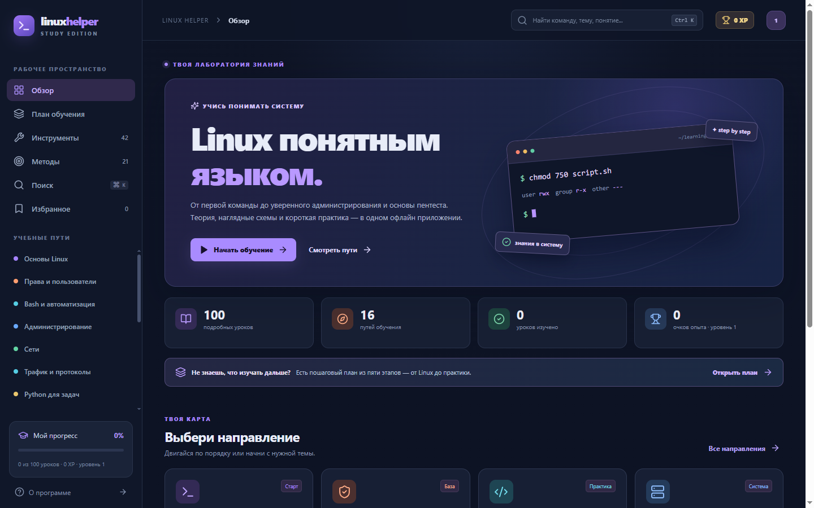

# Linux Helper

Настольный офлайн учебник Linux на русском языке. Помогает изучать работу с системой на уровне, необходимом для администрирования и дальнейшего освоения профессии пентестера.



## Что внутри

- **100 уроков в 16 путях и пяти последовательных этапах:** от Linux и сетей до правовых норм, методологии, веб-безопасности и корпоративной среды.
- **42 инструмента в отдельном справочнике:** назначение, входные данные, пример, чтение результата и пределы применения.
- **21 метод пентеста в атласе:** подготовка, наблюдение, ограничения вывода, защита и ссылки на нужные уроки и инструменты.
- **Наглядные схемы в каждом уроке**, дополнительные диаграммы протоколов и интерактивный тренажёр `chmod` с переключением битов `r/w/x`.
- **Примеры команд**, ожидаемые результаты, замечания по безопасности и короткая самопроверка.
- **Поиск** по русским понятиям, английским командам и распространённым синонимам, с допуском небольших опечаток и фильтрами по путям.
- **Локальный прогресс, избранное и XP:** 20 XP за урок и бонус 100 XP за завершённый учебный путь. Для чтения уроков интернет не требуется.

Приложение даёт учебные примеры; команды нужно запускать осмысленно в собственной лаборатории. Проверки безопасности выполняются только в согласованном контуре.

## Учебная последовательность

1. **Освой систему:** Linux, права, Bash и администрирование.
2. **Пойми сеть и код:** IP/DNS, анализ трафика, Python и криптография.
3. **Освой методологию:** право и стандарты, границы проверки, разведка и доказательства.
4. **Разбери классы рисков:** веб, хосты и корпоративная сеть.
5. **Закрепи и защити:** журналы, укрепление, реакция и практические маршруты.

Главный экран и раздел «План обучения» показывают следующий шаг. Любой урок можно открыть отдельно для справки.

## Скачать

Файлы находятся в [последнем релизе](https://github.com/reasqq/linux-helper/releases/latest).

| Платформа | Файл | Как запустить |
| --- | --- | --- |
| Windows 10 x64 | `Linux-Helper-*-portable-x64.exe` | Запустить без установки |
| Windows 10 x64 | `Linux-Helper-*-setup-x64.exe` | Запустить установщик |
| Kali Linux / Debian x64 | `Linux-Helper-*-x86_64.AppImage` | `chmod +x Linux-Helper-*.AppImage && ./Linux-Helper-*.AppImage` |
| Kali Linux / Debian x64 | `Linux-Helper-*-amd64.deb` | `sudo apt install ./Linux-Helper-*.deb` |

Сборки пока не подписаны сертификатом. Поддержка других платформ может быть добавлена в последующих версиях.

## Разработка

Нужны Node.js 24 и npm.

```bash
npm ci
npm test
npm run build
```

Для локальной разработки интерфейса: `npm run dev`. Для сборки программы на Windows: `npm run dist:win`; на Linux: `npm run dist:linux`. Готовые пакеты появятся в `release/`. Для запуска Electron в режиме разработки можно задать `VITE_DEV_SERVER_URL=http://localhost:5173` и выполнить `npm start` в другом терминале после `npm run dev`.

Исходный код интерфейса находится в `src/`, оболочка Electron — в `electron/`, сборка для обеих платформ — в `.github/workflows/release.yml`. Учебные материалы расположены в `src/content.ts`, `src/bookLessons.ts`, `src/legalLessons.ts`, справочник — в `src/tools.ts`. Это позволяет расширять платформы и содержание независимо.

## Источники

Дополнительные темы вдохновлены книгой Дэниела Г. Грэма «Этичный хакинг. Практическое руководство по взлому» (русское издание, Питер, 2022). Тексты и схемы приложения написаны заново; PDF и книжные иллюстрации в репозиторий не включены. Подробная [карта тем и источников](SOURCES.md) показывает связь разделов с книгой и правовыми материалами. Правовой раздел содержит ссылки на официальные тексты и профессиональные стандарты, проверенные 27 октября 2026 года. Перед реальной работой сверяйте действующую редакцию и согласованные правила проекта.

## Конфиденциальность

Приложение не отправляет прогресс на сервер. Закладки и отметки об изучении записываются в локальное хранилище приложения. Встроенный терминал на экране — иллюстрация; приложение не выполняет команды из уроков автоматически.

## Лицензия

MIT. См. [LICENSE](LICENSE).
